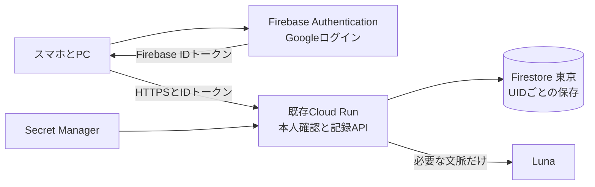

# ログインとクラウド保存の設計

2026年10月19日。こつこつ日和でGoogleログインを使い、同じアカウントならスマホとPCから同じ記録・こむぎと暮らせるようにする。対象は既存GCPプロジェクト `kotokoto-biyori`。Firebase追加・Googleログインプロバイダーの有効化・東京Firestoreの作成は実施済み。認証と保存のアプリ接続を実装した。本人の既存データはまだ移行していない。

初期構成はFirebase AuthenticationのGoogleログイン、東京のCloud Firestore、既存Cloud RunのAPIとする。各人の記録を本人だけに返す。現在の公開URLと部屋中心のUI、Lunaの話し方・推定・配点は維持する。IAPによる特定の閲覧者だけへの制限には戻さない。

## 初回ログイン時の名前設定

初回ログインでは「あなたの呼ばれたい名前」と「犬の名前」を先に入力する。犬の初期値は「こむぎ」、どちらも改行なし20文字以内で、両方の入力を必須にする。Googleの表示名は自動で使わない。その後で端末記録の取り込み/新規開始を選び、選択した名前も同時にクラウド保存する。名前の入力だけで端末の行動・体重・会話を送信しない。

プロフィールv1へ `petName` と `namesConfigured` を追加。従来のプロフィールは犬名「こむぎ」として読み、名前設定済みの印がないログイン済みアカウントには一度だけ両方の入力を案内する。既存の呼び名を入力欄に引き継ぎ、記録と育成は変更しない。設定から両方を変更でき、犬名は画面・吹き出し・履歴の話者・Lunaの本人確認済み文脈に反映する。名前は表示用データとして扱い、HTMLやAIへの命令として解釈しない。過去の会話本文は書き換えない。

## 2026-10-19の初回実装

Googleログイン、UIDに基づく本人確認API、Firestoreへの記録・会話・呼び名・育成/部屋の保存、端末データの明示的な取り込みを実装した。以下の設計には後続の項目も含まれるため、今回の実装範囲はこの節を正とする。

- 未ログインでは端末内の記録と定型の声かけを利用でき、実際のLunaは認証必須。初回ログインでは取り込みか新規開始を選ぶ。既にクラウドがある場合は端末データを自動で混ぜない。
- Googleのポップアップでログインし、開けない場合は同じオリジンのヘルパーによるリダイレクトへ切り替える。Firebase Web SDK 13.0.0 / Admin SDK 14.5.0を固定。基本プロフィール・メール・openidだけを使う。OAuth画面は外部/テストのままで、基本プロフィールのみのスコープのテストユーザー制限例外を利用する。追加スコープを導入する際は公開状態を再確認する。 https://support.google.com/cloud/answer/15549945
- サーバーが保存済み体重・名前・会話からLunaの文脈を作り、配点・クエストを計算して会話と同時に保存する。端末から渡された点数や体重を正本にしない。
- 要求ID・UID単位の永続操作記録、版番号、90秒の会話処理中印、永続利用制限を使う。1ユーザー30回/日・6回/分、全体120回/日・同時2回。日付は日本時間。再起動や別端末からの再送でも同じ要求をAIへ自動で送り直さない。
- 接続時と復帰時、表示中30秒ごとに同期する。変更がない同期は親文書の版番号だけを読む。日別記録・行動それぞれ最大5,000件をまとめて取得し、日報とグラフはその行動から既存ロジックで表示する。期間別ページ分割と日報文書の永続化は後続。
- APIは会話の直近30往復を返す。過去の会話文書は残るが、今回の書き出しも直近30往復まで。全履歴のページ表示/書き出しは後続。
- 取り込みは350文書ずつ準備し、最後にデータセットを有効化する。要求IDと内容のハッシュで再送を判別し、同時に別の取り込みが進むことを防ぐ。中断されたデータセットは未公開で残る。TTLによる中断データの自動清掃は未実装。
- オフラインは最後の同期内容の閲覧と会話下書きの保持のみ。確定記録の自動送信は行わない。端末キャッシュと下書きはUID別に分離し、ログアウト/ユーザー切替で前のキャッシュを消す。取り込み前の元データは残し、取り込み後のゲスト用領域を分ける。
- 会話履歴の削除はクラウドへ反映する。新しい履歴世代へ切り替えてから旧本文を消し、処理済み印を残す。アカウント全体の削除UI/worker、削除台帳、定期清掃は後続。`account_maintenance_ready=false` / `enable_account_maintenance=false` を維持。

## 使うときの流れ

右上の「…」に「アカウント」を追加する。常設のロゴや説明パネルを増やさず、ここでGoogleログイン、保存状況、ログアウト、データ書き出し、アカウント削除を扱う。

| 状態 | 画面と動作 |
| --- | --- |
| 未ログイン | 部屋と端末内の記録を使える。「Googleでログインして記録を保存」をアカウント画面に表示 |
| 初回ログイン | 同期が終わるまで記録の変更を止め、この端末の既存データの取り込みを案内 |
| ログイン済み | 同じアカウントの記録・呼び名・ポイント・育成・所持品・会話を読み込む |
| 保存中 | 入力を保ち、保存完了まで達成や加点を確定しない |
| 保存完了 | アカウント画面に「保存済み」と最終同期時刻を表示。部屋の表示は増やさない |
| 圏外・保存失敗 | 最後の同期内容を閲覧可能にし、編集中の内容は下書きとして保つ。「未保存」と再試行を表示 |
| ログアウト | クラウドの記録は残し、そのアカウントの端末キャッシュ・会話・下書きを消してゲスト表示へ戻る |

ログインは全Googleアカウントに開く。メールアドレスの個別許可リストは設けない。クラウド保存と実際のLunaへの送信はログイン後に限定し、未ログイン時は端末内の記録と定型の声かけを利用できる。現行の未認証チャットAPIを残して制限を迂回できる状態にしない。

最初の版では、圏外で確定記録を追加したりAIと会話したりしない。下書きだけを保持し、復帰後に最新状態を読み直して本人が再試行する。圏外の自動送信・複雑な同時マージは後続機能に分ける。

こむぎが呼ぶ名前は現在の登録名を引き継ぎ、Googleの氏名・写真へ自動置換しない。名前がなければ従来どおりこむぎが尋ねる。メールはアカウントを見分ける画面だけに使い、Lunaの会話文脈へ渡さない。

## 構成とログイン



Firebaseを既存GCPプロジェクトへ追加し、Googleプロバイダーだけを有効にする。メール・パスワード、電話番号、匿名アカウント、Appleログインは初期対象外。ユーザー自身のOpenAI APIキーの登録は不要で、既存のサーバー用キーと利用制限を継続する。[Googleログインの公式手順](https://firebase.google.com/docs/auth/web/google-signin)

スマホは画面遷移によるログインを基本とする。Safari等の第三者ストレージ制限に備え、Cloud Runで同一オリジンの `/__/auth/` を固定の `kotokoto-biyori.firebaseapp.com/__/auth/` へ透過プロキシする。302で転送する方式は採用しない。`authDomain` を現在のCloud Runホストにそろえ、許可ドメインとGoogleのリダイレクトURIを登録する。プロキシは公式の認証ヘルパー経路・必要なGET/POSTだけを扱い、任意のホストへの転送は拒否する。PCも同じ経路を基本にし、アプリ内ブラウザでGoogleに拒否される場合はSafari/Chromeで開く案内を出す。[公式の同一オリジンプロキシ方式](https://firebase.google.com/docs/auth/web/redirect-best-practices)

Firebase Web SDKでログイン状態を保持し、APIごとにIDトークンを取得して `Authorization: Bearer ...` に付ける。独自の認証トークンをlocalStorageに複製しない。Cloud RunはプロジェクトIDを明示したFirebase Admin SDKで署名・期限・発行先・失効を検証し、検証結果のUIDだけを本人の識別に使う。本文やURLから渡されたUID、メール、Googleの直接のIDトークンを本人確認に代用しない。[IDトークンの検証](https://firebase.google.com/docs/auth/admin/verify-id-tokens)

有効なログインを失った場合は401にして入力を下書きに残す。トークン更新はSDKを通して1回だけ試し、それでも失敗したら再ログインを案内する。ログイン復元中にゲストの保存処理や初回取り込みを先走らせない。

## 保存するデータ

Firestore Native modeのデータベース `kotokoto-wellness` を `asia-northeast1` に作る案とする。実装前に既存データベースの有無・利用目的・リージョンを確認し、他用途のデータベースを流用しない。東京を選べるが、これはFirebase認証情報やOpenAIへ送った文まで東京だけに置かれることを意味しない。[Firestoreのロケーション](https://cloud.google.com/firestore/native/docs/locations)

```text
users/{uid}
  datasets/{datasetId}
    settings/profile
    companion/state
    legacyDays/{date}
    activities/{activityId}
    dailyReports/{date}
    threads/{threadId}/messages/{messageId}
    operations/{requestId}
  imports/{importId}
usage/{scopeAndPeriod}
accountDeletionJobs/{jobId}
```

`users/{uid}` はschemaVersion、activeDatasetId、アカウント状態、作成日時を持つ。初回移行を途中のデータのまま見せないため、データセットを準備してからactiveDatasetIdを切り替える。通常の更新は有効なデータセット内で行う。認証自体の氏名・メール・Googleとの紐付けはFirebase Authenticationが持ち、Firestoreへ不要なプロフィールを複製しない。

| 保存対象 | 内容と正本 |
| --- | --- |
| プロフィール | 呼ばれたい名前、日付判定用のタイムゾーン、声かけオンオフ |
| 旧日別記録 | 既存習慣・気分・体重。既存JSONの読込・書出しとの互換用にも維持 |
| 行動 | 種別、実施日、時刻、本人の値、Luna推定と根拠、保留、訂正履歴、削除状態、版番号 |
| 日報 | その日の運動合計、クエスト達成、ポイント内訳、集計ルール版。行動と旧記録からサーバーで計算 |
| 育成と部屋 | 移行時の育成基準、獲得ポイントの過去最高値、なでた時刻、所持品、配置 |
| 会話 | 本人とこむぎのメッセージ、関連行動ID、確定結果。履歴はページ分割して取得 |
| 処理済み操作 | 要求ID、入力ハッシュ、状態、確定結果、再送時の応答 |
| 利用制限 | UID別・全体の利用回数、期間、予約中の呼出し。再起動で消えない形 |

行動・会話・日報を1つの巨大なドキュメントや配列へ詰め込まない。長い本文と推定根拠には検索用の索引を付けず、UID配下の日付順・会話順等の必要な索引だけを作る。日報・育成・グラフは派生値であり、端末から合計点を任意に指定して保存するAPIは作らない。

タイムゾーンの初期値は `Asia/Tokyo`。当日の判定はサーバー時刻とプロフィールのタイムゾーンを使う。「昨日」等の明示した報告日はこれと区別して検証・保存する。過去の記録日はタイムゾーン変更で移動させず、変更後の当日判定だけに反映する。

## APIと同時更新

個人データはすべて既存Cloud Runの同一オリジンAPI経由で扱い、ブラウザからFirestoreを直接読み書きしない。以下は経路案で、実装時もUIDをリクエストから自由に選ばせない。

| API | 役割 |
| --- | --- |
| `GET /api/me` | ログイン本人、初期設定、同期revision、移行状態 |
| `GET /api/sync` | プロフィール・育成・直近14日分の記録と日報を取得。ETagで変更なしを返せる |
| `GET /api/records?from=...&to=...` | 指定期間の記録。件数上限とページ送りを必須にする |
| `POST /api/commands` | 記録・訂正・名前・所持品・配置・なでる等、許可した操作だけを検証して保存 |
| `POST /api/chat` | 保存済み文脈からLunaへ送信し、返事と行動・日報・育成を確定して返す |
| `GET /api/operations/{requestId}` | 通信が切れた後、実際には保存されたかを確認 |
| `GET /api/conversations` | 保存済み会話をページ単位で取得 |
| `POST /api/imports/preview` と `/commit` | 既存記録を検証し、本人が確認した内容だけを移行 |
| `GET /api/export` | ログイン本人のバックアップを書き出す |
| `DELETE /api/conversations` | 会話履歴だけを消す。行動記録とポイントは保持 |
| `DELETE /api/account` | 再認証と画面内の最終確認後、アカウントと個人データの削除を開始 |

更新にはUUID形式のrequestIdと対象のexpectedVersionを付ける。同じUID・requestId・入力なら保存済み結果を返し、同じIDに異なる入力なら409とする。異なる操作は別ID。別端末の訂正で対象の版が進んでいれば、上書きせず409と最新内容を返し、下書きを残す。過去の削除・訂正も版を持たせ、古い画面からの保存で復活させない。

日別の行動追加は、対象日の日報・UID全体の集計基準・処理済み操作を同じFirestoreトランザクションで検証し、合計から再計算する。訂正で日付が変わる場合は移動前後の両日を更新する。1日1回のクエスト、運動の非線形な式、減点なし・育成の過去最高値は既存仕様を引き継ぐ。見た目の数字を先に加算してから同期する方式は使わない。

トランザクション内の関数は競合で再実行され得るため、Luna呼出しや他の外部処理をその中で行わない。[Firestoreのトランザクション](https://firebase.google.com/docs/firestore/manage-data/transactions)

会話は次の順序にする。

1. 本人確認、入力検証、requestIdの照合を行い、UID単位で会話中の操作を1件に絞る。別端末の同時送信には「返事を待っているよ」と再試行を返す。
2. Firestoreに処理中状態と期限付きリース、利用枠の予約を保存し、その時点の記録・最新体重・会話を読む。クライアントが渡した点数や全履歴で正本を置き換えない。
3. トランザクションの外でLunaを呼び、構造化された結果を検証して保存する。
4. 文脈に用いたデータのrevisionを再確認する。変化があれば曖昧な判定を自動確定せず、候補を保留して再確認できる状態にする。
5. 返事、確定する行動、日報、育成、操作結果を一緒に保存し、確定した結果をブラウザへ返す。保存後に応答を失っても同じrequestIdで取り出せる。

外部AIの応答後・結果保存前にプロセスが停止した場合、AIが実行されたかをFirestoreだけで完全には証明できない。期限切れの処理を勝手に再呼出しせず「結果を確認できなかった」と扱い、本人の再送操作を必要にする。この場合の新しいAI呼出しには追加の利用が生じ得る。ポイントの確定は操作IDで1回に限定する。操作の受付記録はデータセットの存続中保持し、会話を消した後の古い再送も再実行しない。

利用制限は現行の毎分6回・本人1日30回・全体1日120回を初期値とし、UID単位へ変更する。日付境界は利用制限については一律JSTと明記する。全体同時2回も期限付きリースで管理し、再起動や複数端末でリセットされないようにする。予約はAI呼出し前に確定し、実行有無が不明な失敗では枠を返さない。Googleログインだけで無制限利用や全体の費用上限を保証できるわけではなく、全体枠も残す。

## 同期と端末内データの分離

ログイン後はFirestoreが正本。端末には最後の同期内容と下書きだけをUID別の名前空間で保持する。ゲスト用の既存5キーをそのままアカウントの作業領域として使い回さない。アカウント切替時は前のUIDの表示を直ちに消し、古い通信応答も世代番号で破棄する。保存失敗や401の際にゲスト領域へ書き戻さない。

初回表示・画面復帰・自分の保存後に同期する。前面にある間は30秒ごとにrevisionを軽く確認し、変更がある場合だけ必要な期間を取得する。隠れたタブでは止める。最初からFirestoreの常時リスナーや全履歴の再取得を使わず、他端末の変化は通常30秒以内または画面復帰時に反映する。ページ分割中のrevisionが変わった場合は混ざったスナップショットを表示せず取得をやり直す。

動きを減らす・手動の動き停止・キーボード配置など端末に依存するUI設定は端末に残す。呼び名・声かけオンオフは同期するが、声かけの直近時刻と自動声かけ履歴は端末に残す。犬の現在座標や歩行の途中は保存・同期しない。

## 既存データの引き継ぎ

現在は次の5キーに分かれている。すべて端末・ブラウザ・オリジンに依存しており、ログインだけで別端末や旧SitesのlocalStorageを読み取ることはできない。

| 既存キー | 移す内容 |
| --- | --- |
| `kotokoto-wellness-v1` | 日別習慣・体重・気分、所持品・配置、最後になでた時刻 |
| `kotokoto-progress-v1` | 行動、保留、訂正、処理済み要求ID、育成基準と過去最高値 |
| `kotokoto-profile-v1` | 呼ばれたい名前 |
| `kotokoto-komugi-conversation-v1` | 保存済みの会話履歴 |
| `kotokoto-companion-chat-v1` | 声かけオンオフのみ。自動の声かけ履歴は端末内に残す |

初回ログインの取り込みは以下とする。

1. ログイン前の既存データを上書きせず、ローカルの移行用スナップショットを作る。JSONの書き出しも利用できるようにする。元の形式が壊れている・未知の版なら取り込みを止め、原本を残す。
2. 件数、日付範囲、体重記録の有無、育成段階、会話を移すかを本人に見せる。「この端末の記録をアカウントへ保存する」を明示して選んでもらう。健康記録・会話をログインだけで自動送信しない。
3. サーバーはschema・サイズ・日付・IDを検証し、importIdと内容ハッシュを保存する。大量の記録はステージング領域へ上限内の小分けで保存する。
4. 全件検証後にactiveDatasetIdを切り替える。途中で通信が切れても前の有効データセットが見え続け、同じimportIdで続きから再開する。途中の再送で新しい報酬を付けない。
5. 読み戻した件数・ID・主要な値を照合して成功を示す。元のゲストキーは読み取り専用の退避データとして残し、移行済みUIDとハッシュを別に記録する。自動で再取り込みしない。ログアウトで別の人のゲスト記録として再表示しない。

旧ポイント合計はそのまま新しい加点として足さず、移した行動と既存ルールから日報を再計算する。既存progressのbaselineとpeakは移行由来の育成基準として検証・保存し、育った姿となつき度を引き継ぐ。別端末のbaselineやpeakを足し算しない。これはローカル時代の本人データの引き継ぎであり、その来歴をサーバーが証明した実績にはしない。将来の有償報酬等には転用しない。

クラウドにすでにデータがある場合は、クラウドを読み込み、この端末のデータを自動で混ぜない。必要な場合だけ別の「バックアップを取り込む」操作を案内する。同一ID・同一内容は除外し、同一IDで内容が違うものや日時・種類が似た行動はプレビューで確認する。行動のIDが違うだけで別行動と断定しない。名前・同日の体重・配置の競合はどちらを残すか本人が選び、置換前のバックアップとrevisionを保持する。最初の版では任意の2データセットの自動マージを提供しない。

旧Sitesからは、そのオリジンでのJSON書き出しと、新URLでのプレビュー付き読み込みを使う。既存version 1のJSONが含む範囲だけを復元し、含まれない会話等を移せたとは表示しない。保存済みのJSONバックアップも同じ検証経路で扱う。

## アクセス制御と削除

FirestoreのWeb/Mobile Security Rulesは全拒否にする。Cloud Runのサーバー用ライブラリはIAMで動作するので、これだけではユーザー間の分離にならない。API側で必ず検証済みUIDからパスを組み、全ての読取・更新・履歴・書出し・削除に同じ認可を適用する。サーバー実行SAには対象DBのデータ利用と認証状態の照会に必要な権限だけを付与する。ユーザーの無効化・トークン失効・削除を行う削除ジョブは別SAに分け、通常の記録APIへ認証管理者権限をまとめて与えない。[サーバー用ライブラリのIAM](https://cloud.google.com/firestore/native/docs/security/iam)

API応答は `Cache-Control: no-store`。トークン・会話本文・体重・バックアップ本文はログへ出さない。アプリの更新APIは許可オリジンとメソッドを検査し、CORSで他サイトへ個人データを開放しない。表示はtextContent等を使い、呼び名や会話をHTMLとして挿入しない。SDKは版を固定して依存関係を管理する。

ログアウトはこの端末からの退出で、クラウド削除ではない。アカウント削除は別の操作にし、直近のGoogle再認証と「記録とこむぎの育成も削除される」ことの確認を必要にする。削除中はアカウントを利用不可にしてトークンを失効させ、記録・サブコレクション・会話・操作記録・移行ステージングとFirebaseのユーザーを削除する。親ドキュメントの削除だけで終わらせない。ジョブを永続化し、定期的なCloud Run Jobで中断分を再実行する。即時に全件消えたと表示せず、完了状態を確認できるようにする。

初期の会話履歴は本人が消すまで保存する。会話削除では本文と会話由来の再送応答を削除し、行動記録・推定根拠と点数は残すことを画面で示す。AIへ過去の会話を送らない状態へ戻し、古い操作は本文なしの処理済み印だけを残して再実行を防ぐ。

FirestoreにはPITRを有効にする案とし、誤削除・破損時の復旧手順を用意する。PITRは最大7日間の過去データの復旧に使えるが、日常の同期とは別機能で追加費用がある。削除した人のデータが復旧で再び有効にならないよう、復旧対象と別に削除管理記録を保持して再適用する。初期案ではPITRの履歴を最大7日、本文を含まない削除管理記録を30日保持する。削除管理記録は復旧で巻き戻さない別の保管先に置き、UID照合用の情報だけを保持する。バックアップ内の削除済みデータも保持期間の満了まで残り得るため、その期間を削除画面と運用手順に明記する。[PITRの概要](https://cloud.google.com/firestore/native/docs/pitr)

## Terraformと実装の順序

具体的なroot分割・resource・入力出力・既存DBの取り込みは [認証とFirestoreのTerraform設計](auth-storage-terraform-design.md) を参照。永続データはdata、FirebaseとWeb登録はauth、実行イメージに依存する削除Jobはappで管理する。以下の概略に対し、この具体設計を優先する。

既存bootstrap・foundation・appの責任分担とCloud Build→ダイジェスト→Terraformの公開手順を継続する。データ保存関連は独立した `infra/terraform/data` に分け、データベース・索引・Rules・PITRと復旧用の削除管理記録を管理する。削除ジョブはapp構成に置く。データベースは削除保護とprevent_destroyを設定し、アプリ更新による作り直しを防ぐ。

必要API、既存プロジェクトへのFirebase追加、Webアプリ登録、認証の設定、DBと実行SAの権限をコード化する。利用中のGoogle providerでの対応を確認して実装し、OAuthクライアントシークレットをTerraform変数・stateへ直接入れない。プロバイダー設定のうち秘密値を要求する初期操作は、対応する安全なコンソール手順として残す。Firebase Web設定の公開用APIキーと、サーバーのOpenAIキー・OAuth秘密値を区別する。既存のSites IDやIAP設定は変更しない。

1. データアクセス層を切り出し、既存の計算関数をサーバー側でも共有する。ローカルデータを変更しない状態で回帰テストを作る。
2. AuthとFirestoreのエミュレーターで本人分離、操作の再送、訂正・競合・移行を実装する。架空の記録だけを使う。
3. GCPにAuth・Firestore・Rules・権限・PITRを準備する。Google同意画面の公開状態と許可ドメインを確認し、テストユーザー限定のまま一般利用可能と表示しない。
4. Googleログインの往復をiPhone Safari・Android Chrome・PCで検証する。現URLで認証ヘルパーが動くことを確認してから切り替える。
5. 個人データAPIと認証必須のチャットを同じリリースで有効にし、前の未認証APIを閉じる。本人確認に失敗したときに旧経路へフォールバックしない。
6. 本人が選んだ端末の既存記録をプレビューして取り込む。別端末で件数・日報・育成・呼び名が一致することを確認する。

## 完了条件

- 同じGoogleアカウントなら、別端末で同じ記録・呼び名・こむぎの育成・会話を開ける。
- 未ログイン・他人のUID指定・期限切れ/偽造/別プロジェクトのトークンで個人データや有料AI経路を利用できない。
- 別アカウントへ切り替えても前の記録・下書き・遅れて届いた応答が混ざらない。
- 同日を2端末から追加してもクエストは1日1回、同じrequestIdの再送で加点は1回だけになる。
- 同時訂正・日付移動・削除の競合で古い値が復活せず、日報とグラフと累計が一致する。
- AI待ちの中断・サーバー再起動・応答受信前の切断でも、確定状況を確認でき、曖昧なAI再呼出しを自動で増やさない。
- 圏外や保存失敗を保存済みと表示せず、下書きから本人が再試行できる。
- 既存5キー、旧JSON、未知の版、途中切断、同じ移行の再送、クラウドに既存記録がある場合を検証し、原本を失わない。
- Googleの表示名がこむぎの呼び名を勝手に変えない。部屋・吹き出し・スマホの入力と動きを維持する。
- 会話削除、ログアウト、アカウント削除と中断後の再開、バックアップ復旧時の削除再適用を検証する。

初期版に含めないのは、家族間の共有、ランキング、公開プロフィール、パスワード認証、完全オフライン同期、自動マージ、Appleログイン。費用はFirestoreの読取・書込・保存・PITR、認証の契約方式と利用人数、Cloud Run、Luna利用から成る。無料枠だけで足りるとは扱わず、実装時に現在の料金と想定人数で別途試算する。

## 日単位のオーナー記憶（2026-10-19）

会話入力を「過去のサマリー＋今日の全対話＋最新の登録名/記録」に変更する。日本時間の日付が変わって最初に話しかけたとき、未要約の過去日分と旧サマリーから新しい記憶を作り、保存してから今日の返事を生成する。アプリを閉じるときの処理や深夜のSchedulerは使わない。会話のない日は更新せず、間が空いた場合は未要約の過去日分を時系列でまとめて処理する。

保存先は users/{uid}/datasets/{datasetId}/memory/owner。version/revision/summary/outputTokenUpperBound/throughDate/throughSequence/updatedAtを持つ。処理済みの最終メッセージsequenceを保存し、同じ対話を何度も取り込まない。会話本文は引き続きthreadのmessagesに残す。UIの直近30往復とは独立して未要約の全文書をsequence順に読み、今日の対話を8往復などに削らず最大30往復すべて渡す。明示的な記憶リセット以前の会話は除く。

LunaのResponses APIへ max_output_tokens=2000 / reasoning low / store falseを指定し、completedかつusage.output_tokensが整数1〜2000の応答のみ保存する。拒否・途中終了・異常値では旧記憶とカーソルを維持する。output_tokensは推論/書式等も含むため、保存本文のトークン数の保守的な上限として扱い、厳密な本文トークン数とは表示しない。モデルには800〜1200トークンを目安に整理するよう指示する。[公式の出力上限とusageの説明](https://developers.openai.com/api/docs/guides/reasoning#controlling-costs)

既存のUID別会話lease・永続要求ID・版番号で更新を守る。トランザクションの外で要約し、保存直前に要求ID/lease/履歴世代/状態と記憶の版を再確認する。記憶は返事の生成より先に確定するため、返事が失敗してもその過去日分を自動で再要約しない。同じ要求IDの再送は処理中または保存済み結果だけを返す。プロセス停止で結果不明の要求は自動で再実行しない。要約失敗は対話と旧記憶を残し、本人の明示的な再送を可能にする。別の要求IDで利用者が再試行した場合は、未確定の要約を再生成する場合がある。

本人の上限は会話30件/日・6件/分。全体120回/日は要約も含めたAI呼び出し数として数え、日付またぎ時は要約と返事の2回分を事前に確保する。失敗時に利用枠を返さない方式と同時実行2枠は維持する。要約20秒・返事25秒、クライアント55秒の上限。未要約2000メッセージまたは要約入力120,000文字を超える異常な移行データは、黙って切り捨てずエラーとする。通常は1日最大60メッセージで、この範囲に収まる。

設定の「覚えていること」で本文と反映日を確認できる。「記憶をリセット」は本文を消し、過去の対話を処理済みとして飛ばす。履歴は残るが、その古い本文を翌日の要約や今日の会話入力へ自動で戻さない。「履歴を消す」は履歴世代を変えると同時にサマリーも消し、旧本文と操作結果本文を削除する。行動記録とポイントには触れない。自然な会話での「忘れて」は現在の会話と次のサマリー更新で尊重するよう指示する。即時に記憶全体を確実に消す場合は設定のリセットを使う。

記憶は命令ではなく参考データ。現在の登録名・確定記録・本人の最新の訂正を優先する。本人が述べていない属性、助手の推測、架空/引用の内容、健康状態の推断を事実として保存しない。体重やポイントの正本は既存記録で、長期記憶へ数字を複製しない。認証情報・連絡先も残さない。本文はFirestore索引対象外にする。


### プロンプトキャッシュ（2026-10-19）

- Responses入力を「固定指示 → 登録名 → 前日までの記憶 → 今日の対話と今回の発言 → 最新の日付・時刻・体重・行動記録」の順にする。後尾のdeveloperメッセージは参考データとして定義し、最後のuser発言に応答する。現在の記録を古い会話より優先する仕様は維持する。
- gpt-6-lunaの `prompt_cache_options={mode:implicit,ttl:30m}` を使用。固定指示・登録名・記憶の各input_textにexplicit breakpointを置き、最新userメッセージのimplicit境界までを再利用候補にする。変化する末尾の記録は書き込み境界の後に置く。履歴を追記しても以前のuser境界はimplicit lookup対象となる（無制限の全境界検索ではない）。
- 日次要約は固定指示だけにexplicit境界を置く。日ごとに異なる対話本文をキャッシュへ書き込むための追加料金を避ける。固定部分が最小長1024トークンに達しない場合はキャッシュ対象にならない。キャッシュのためだけの水増しはしない。
- `server/prompt-cache.mjs` がCloud Loggingへ `openai_prompt_cache` をJSON出力する。purpose、inputTokens、cachedTokens、cacheWriteTokens、outputTokens、elapsedMsのみ。UID・名前・会話本文・記憶・健康数値・APIキーを含めない。未提供のusage値はnullとし、0と混同しない。ログ出力の失敗は会話の成功を妨げない。
- 実測のトークン再利用率は集計cachedTokens / 集計inputTokens。キャッシュ書き込みにも料金がかかるためcacheWriteTokensも併せて確認する。ヒット・速度・費用の削減率を保証しない。`store:false`、reasoning low、日次記憶の2000出力上限は維持する。
- 検証スクリプト `node scripts/check-prompt-cache.mjs` は登録済みSecret Managerキーをメモリで参照し、架空のボールの雑談3件だけで実APIを検証する。実ユーザーの記録・名前・健康情報は取得しない。アカウントの記録・ポイントは変更しない。
- 公式仕様: https://developers.openai.com/api/docs/guides/prompt-caching

キャッシュ実測: 架空のボールの雑談をローカルから本番と同じモデル/キー/生成コードで3回送信。input/cached/writeは順に3470/0/3409、3470/3409/0、3519/3409/49。2回目の入力トークン再利用率98.24%、会話追記後も96.87%。所要時間2272/3407/1484msで、速度向上の保証にはしない。Cloud Run経由の実ユーザー会話テストではない。全Node106件成功。
